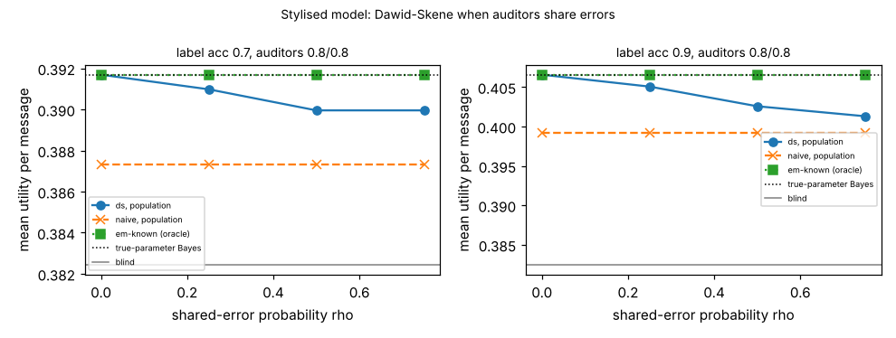

# ambient-dscorr: Dawid-Skene when the two auditors share errors

Track 2 (ambient AI assistant), follow-up to `ambient-dsaudit` (its first "Next step": correlated auditor errors). Produced with AI assistance. **Stylised, simulated results only**: every parameter is a round figure I chose, the classifier and both auditors are made-up uniform-error confusion matrices, and nothing is a claim about a real user, device or product.

## Motivation

`ambient-dsaudit` showed that Dawid-Skene (DS) EM learns the urgency label's reliability from two auditors with no accuracy supplied, but only when the auditors err independently. Real auditors tend to stumble on the same hard messages. This project asks how much that costs: how wrong do the fitted matrices get, and how much utility is lost?

## Builds on (and does not claim affiliation with)

- `research/ambient-dsaudit` (and through it `ambient-noisyaudit`, `ambient-confest`, `ambient-misread`) in this repository: the Bayes policy, the 48 contexts, 3 urgency classes (mix 50/35/15%), and the DS estimator. `src/ambient_dscorr/sim.py` and `est.py` are copies, with the shared-error sampler added, so the project is self-contained.
- Dawid and Skene (1979), "Maximum likelihood estimation of observer error-rates using the EM algorithm", *Applied Statistics* 28(1), 20-28 (citation from memory, not re-read here).

No research group from `prompt.md` is built on; there is no lab tag.

## Method

Shared-error model: for each message, with probability `rho` auditor 2's label is a copy of auditor 1's label; otherwise it is drawn independently. Both auditors have the same accuracy (0.8/0.8 or 0.7/0.7), so each one's own accuracy does not change with `rho`, but they now agree more often than independence allows. (With unequal auditors, auditor 2's marginal would become a mixture of the two matrices; a test pins this, and the experiment avoids it.) `rho` = 0, 0.25, 0.5, 0.75. Classifier label accuracy 0.7 or 0.9.

Estimators, each followed by Bayes' rule and scored exactly under the truth, as the mean over 48 contexts: **naive** (auditor 1's label taken as truth), **em-known** (EM with auditor 1's true matrix given, one label per message; an oracle, unaffected by `rho`), and **ds** (Dawid-Skene assuming independence, as in `ambient-dsaudit`). "Population" uses exact expected counts; finite cells use n = 200 and 1000 with 200 audit sets each.

## Reproduce

```bash
cd research/ambient-dscorr
pip install numpy pytest matplotlib
PYTHONPATH=src python3 -m pytest -q tests        # 7 tests
PYTHONPATH=src python3 experiments/run.py > experiments/results.txt   # about 6 minutes; also writes experiments/dscorr.png
```

## Results (all from `experiments/results.txt`; mean utility per message over contexts)

Reference: blind 0.3824; true-parameter Bayes 0.3917 (label 0.7) and 0.4066 (label 0.9), i.e. gains over blind of 0.0093 and 0.0242.

1. **Shared errors make DS over-trust the auditors and under-trust the classifier.** With auditors 0.8/0.8 the population fit reads the auditors as 0.858, 0.909 and 0.957 at rho = 0.25, 0.5, 0.75 (truth 0.8), and a label of true accuracy 0.7 as 0.647, 0.613, 0.588. With a 0.9 label and 0.7/0.7 auditors, the label is read as 0.757, 0.689, 0.645.
2. **The utility cost is real but depends on the cell.** Population loss of DS against true-parameter Bayes at rho = 0.5: 0.0017 (18% of the gain; label 0.7, auditors 0.8/0.8), 0.0051 (55%; label 0.7, 0.7/0.7), 0.0040 (17%; label 0.9, 0.8/0.8) and 0.0074 (31%; label 0.9, 0.7/0.7). The worst cell is label 0.9, auditors 0.7/0.7, rho = 0.75: DS gets 0.3943, essentially the naive estimator's 0.3941, a loss of 0.0123 (51% of the gain).
3. **DS never fell below the naive estimator in any cell here**, population or finite (n = 200, 1000), though its advantage shrinks to nothing in the worst cell. So in this model, correlated errors erase DS's benefit over treating one auditor as truth in the worst case, but do not make it worse.
4. **Against the single-label oracle, DS goes from level to behind.** At rho = 0 DS is within 0.0011 of em-known at n = 200 (ahead in three cells, behind in one). At rho = 0.75 and n = 1000 it is behind by 0.0022, 0.0050, 0.0054 and 0.0099 across the four cells. (em-known is told auditor 1's true matrix, which is not available in practice; it is a ceiling, not a competitor.)
5. **More data does not repair it**: for rho >= 0.25 the DS shortfall against em-known is no smaller at n = 1000 than at n = 200 (for example label 0.9, 0.7/0.7, rho = 0.5: 0.0060 at n = 200, 0.0072 at n = 1000), because the bias is structural, not sampling noise. P(DS below blind) was at most 0.07, in the rho = 0 cell with two 0.7 auditors at n = 200 (small-sample noise, not correlation).



## Limitations

- One simple form of dependence (copying with probability rho), identical auditors, uniform-error matrices, one class mix and one utility set. Numbers depend on these round figures; only the ordering is the claim, for this model.
- No remedy was tested (modelling the dependence, a gold subset, or auditors who label different messages). Those are the next steps.
- DS used unrestricted matrices and one start, as in `ambient-dsaudit`. 200 audit sets per finite cell. Citations are from memory and were not re-read.

## Next steps

- Dependence-aware EM (a latent hard-message indicator) and whether it is identifiable with two auditors.
- A gold subset of perfectly audited messages to anchor DS under dependence.
- Unequal auditors, and errors that favour adjacent classes.
